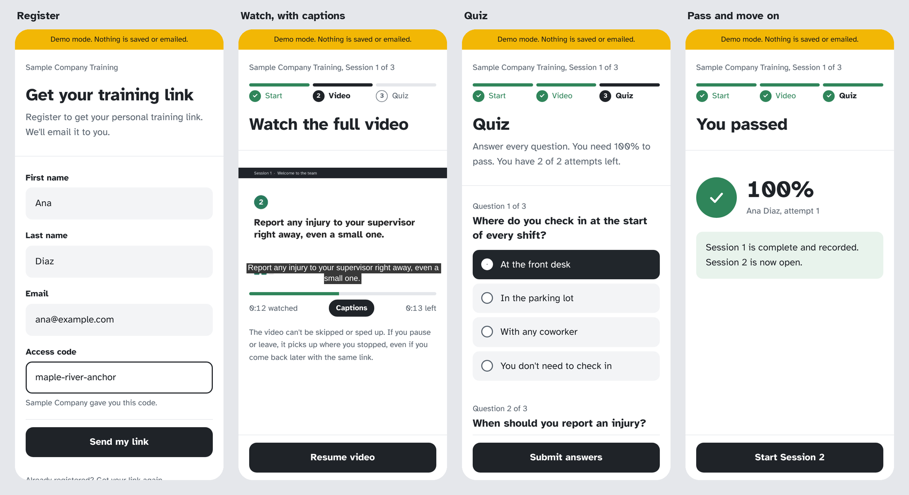
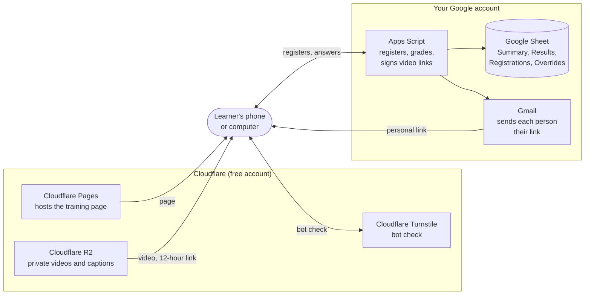

# ReadyLine by Makersridge

**Free video training, quizzes, and proof of completion for small teams. No per-person fees.**

**[Try the demo](https://a-makersridge.github.io/readyline-training/site/)** on your phone or computer. The sign-up form comes filled in (any email works, like test@gmail.com), so just tap **Send my link**, then **Open my training link (demo)**. It runs with sample sessions, and nothing is saved or emailed. The demo adds a **Skip the video** button so you can flip through every screen in a few minutes; your live training never shows it.

ReadyLine turns your training videos into a guided course. People register, watch each video without skipping, pass a quiz, and move on to the next session. Every result lands in a Google Sheet you own, with one row per person and a full record of every attempt.

It was built for teams that bring on a lot of people and can't pay per seat for a learning platform: staffing agencies, warehouses, light industrial and hospitality employers, franchises, and any small business with recurring onboarding.



## What it does

- **Registration with an access code.** People enter their name, email, and the code you give them. A bot check runs in the background.
- **A personal link by email.** One link covers every session. If someone loses it, they can request it again with just their email.
- **Videos that can't be skipped.** No controls, no fast-forward, no speed change. The video pauses if they leave the page and picks up where they stopped.
- **Quizzes graded in Google.** The answer key never reaches the browser. You set the passing score and the number of attempts.
- **Sessions in order.** Each session opens when the one before it is passed.
- **English and Spanish.** Offer one language or both. Everything a learner sees, including the email, follows their choice.
- **Records you own.** A Google Sheet with a Summary tab (one row per person), a Results tab (every attempt and every answer), and an Overrides tab for granting extra attempts.
- **Private videos.** Stored in a private Cloudflare R2 bucket and shown through links that expire after 12 hours.
- **Captions.** Add a caption file to any video. Captions show by default, and learners can turn them off.
- **A plain white look you can brand.** Set two colors to match your company, or fill the header with your brand color. Dark mode is built in.

## How it works

ReadyLine has no server of its own. Cloudflare hosts the page and the videos. A Google Apps Script attached to your Sheet does everything else: registering people, grading quizzes, opening sessions in order, sending emails, and keeping records.



The learner's browser never talks to your Sheet. Every request goes through the script, which checks the bot-check result, signs a fresh video link, and writes the record.

## What you'll need

Everything below has a free plan that covers a small team. You'll create two accounts (Google, if you don't have one, and Cloudflare) and download one free app.

| Tool | What ReadyLine uses it for | Cost | Credit card? |
|---|---|---|---|
| [Google Sheets](https://workspace.google.com/products/sheets/) and [Apps Script](https://developers.google.com/apps-script) | Records, grading, registration, and the link email. Apps Script is built into every Google Sheet (Extensions > Apps Script). | Free with any Google account | No |
| [Cloudflare account](https://dash.cloudflare.com/sign-up) | One login for the three Cloudflare tools below. You don't need to move your website or domain. | Free | No |
| [Cloudflare R2](https://developers.cloudflare.com/r2/) | Stores your videos and captions privately | Free up to 10 GB of storage a month, with no charge for viewing ([pricing](https://developers.cloudflare.com/r2/pricing/)) | Yes. Cloudflare asks for a payment method to turn on R2, even on the free tier. |
| [Cloudflare Turnstile](https://developers.cloudflare.com/turnstile/) | Keeps bots out of registration, usually without the learner noticing | Free plan with unlimited checks ([plans](https://developers.cloudflare.com/turnstile/plans/)) | No |
| [Cloudflare Pages](https://developers.cloudflare.com/pages/) | Hosts the training page | Free plan | No |
| [HandBrake](https://handbrake.fr) | Optional app that makes your videos start playing fast | Free | No |
| A video tool: [Canva](https://www.canva.com), [Clipchamp](https://clipchamp.com), or PowerPoint | Turns your slides into narrated MP4 videos. Our videos were made in Canva with its AI voiceover. See [MAKING-VIDEOS.md](docs/MAKING-VIDEOS.md). | Free plans available; paid plans add more AI voices | Depends on the plan |

**Which Google account?** A Google Workspace (company) account can send about 1,500 emails a day. A personal Gmail account can send about 100 ([Google's limits](https://developers.google.com/apps-script/guides/services/quotas)). Each new learner gets one email, so a personal account works for up to about 100 new people a day.

**Why Cloudflare for the videos?** Cloudflare Pages won't host a file larger than 25 MiB ([limits](https://developers.cloudflare.com/pages/platform/limits/)), and most training videos are larger. R2 holds them privately and doesn't charge for people watching them.

You'll also need your **videos** as MP4 files ([how to make them](docs/MAKING-VIDEOS.md)) and your **quiz** with its answers. The [quiz templates](docs/QUIZ-TEMPLATE.md) are the easiest way to write it down.

## Try it first

The [live demo](https://a-makersridge.github.io/readyline-training/site/) shows the whole learner experience. You can also open `site/index.html` with the settings untouched and it runs in **demo mode**: the sample sessions, sample videos, and quizzes all work in your browser, with nothing saved or emailed. To try it locally, start a simple web server in this folder (for example `npx serve .`) and open `/site/`.

## Setting it up

Plan on one to two hours the first time. You don't need to write code. You will copy and paste settings, click through Google and Cloudflare, and upload files.

1. **[Read the setup guide](docs/SETUP.md).** It walks through every click, with an AI prompt at each step if you get stuck.
2. Prepare your videos as MP4 files, and fill in the [quiz templates](docs/QUIZ-TEMPLATE.md).
3. Set up Cloudflare R2, Turnstile, the Google Sheet and script, and Cloudflare Pages.
4. Run through it yourself, then [share the link](docs/SHARING.md), with a QR code if you like.

## Set it up with any AI assistant

You can have ChatGPT, Claude, Gemini, Copilot, or any other AI assistant walk you through setup one step at a time. Paste this prompt in to start:

```
I'm setting up ReadyLine by Makersridge, a free open-source training tool
(github.com/a-makersridge/readyline-training). It uses Google Sheets and Apps Script,
Cloudflare R2, Cloudflare Turnstile, and Cloudflare Pages. I'm not a developer.

Walk me through the setup one step at a time, in this order:
1. Prepare my videos as MP4 files
2. Store them in a private Cloudflare R2 bucket
3. Create a Cloudflare Turnstile widget
4. Create the Google Sheet, paste in Code.gs, fill in YOUR SETTINGS, add the Script Properties,
   and run setup and testVideoLinks
5. Deploy the script as a web app (Execute as Me, access Anyone)
6. Fill in the settings at the top of site/index.html and make the upload zip
7. Upload the zip to Cloudflare Pages
8. Test it end to end

Give me one step at a time, wait for me to say it's done, and tell me what I should
see when it worked. If I paste an error, help me fix it before moving on.
Never ask me for my secret keys; I'll keep those to myself.

About my training: [number of sessions], [English / Spanish / both],
my Google account is [Google Workspace / personal Gmail].
```

### AI prompts for each step

Stuck on one step, or prefer to go step by step? Open the step, copy the prompt, fill in the brackets, and paste it into any AI assistant. The same prompts appear in the [setup guide](docs/SETUP.md).

<details>
<summary><strong>1. Prepare your videos</strong></summary>

```
I'm setting up ReadyLine by Makersridge, a free open-source training tool that uses Google Sheets and Apps Script, Cloudflare R2, Cloudflare Turnstile, and Cloudflare Pages. I'm not a developer.

I have a [PowerPoint / Keynote / Google Slides] presentation with [recorded narration / no narration] on [Windows / Mac].
Walk me through exporting it as an MP4 video, then making it web-optimized in HandBrake so it starts playing fast.
I need one video per session per language, named session-1-en.mp4, session-1-es.mp4, and so on.
Keep each step short and tell me how to find each video's length in minutes.
```

</details>

<details>
<summary><strong>2. Store the videos in Cloudflare R2</strong></summary>

```
I'm setting up ReadyLine by Makersridge, a free open-source training tool that uses Google Sheets and Apps Script, Cloudflare R2, Cloudflare Turnstile, and Cloudflare Pages. I'm not a developer.

Walk me through creating a private Cloudflare R2 bucket named [bucket name], uploading my videos,
and creating an R2 API token with Object Read only permission limited to that bucket.
Tell me exactly which values to copy (Account ID, Access Key ID, Secret Access Key) and where each one goes.
Don't ask me to paste the secret key here.
```

</details>

<details>
<summary><strong>3. Create the bot check (Cloudflare Turnstile)</strong></summary>

```
I'm setting up ReadyLine by Makersridge, a free open-source training tool that uses Google Sheets and Apps Script, Cloudflare R2, Cloudflare Turnstile, and Cloudflare Pages. I'm not a developer.

Walk me through creating a Cloudflare Turnstile widget in Managed mode for a site at [your-project].pages.dev.
Explain the difference between the Site Key and the Secret Key and where each one goes:
the Site Key in site/index.html, the Secret Key in Apps Script Script Properties.
```

</details>

<details>
<summary><strong>4. Create the Google Sheet and script</strong></summary>

```
I'm setting up ReadyLine by Makersridge, a free open-source training tool that uses Google Sheets and Apps Script, Cloudflare R2, Cloudflare Turnstile, and Cloudflare Pages. I'm not a developer.

Walk me through creating a Google Sheet, opening Extensions > Apps Script, and pasting in Code.gs.
Then help me fill in YOUR SETTINGS at the top: training name, sender name, access code, languages,
support contacts, passing score (PASS_PERCENT), quiz attempts (MAX_ATTEMPTS), and my R2 Account ID and bucket.
Then show me how to add three Script Properties (R2_ACCESS_KEY_ID, R2_SECRET_ACCESS_KEY, TURNSTILE_SECRET)
and run the functions setup and testVideoLinks. Tell me what a successful log looks like.

If something fails, here's the log: [paste the log, never your keys]
```

</details>

<details>
<summary><strong>5. Publish the script as a web app</strong></summary>

```
I'm setting up ReadyLine by Makersridge, a free open-source training tool that uses Google Sheets and Apps Script, Cloudflare R2, Cloudflare Turnstile, and Cloudflare Pages. I'm not a developer.

Walk me through deploying my Google Apps Script as a web app with Execute as Me and access for Anyone,
and copying the web app URL that ends in /exec.
Then explain how to update it later with Manage deployments > New version so the URL never changes.
```

</details>

<details>
<summary><strong>6. Connect the page</strong></summary>

```
I'm setting up ReadyLine by Makersridge, a free open-source training tool that uses Google Sheets and Apps Script, Cloudflare R2, Cloudflare Turnstile, and Cloudflare Pages. I'm not a developer.

I need to fill in the settings block at the top of site/index.html without breaking it. Here's the block:
[paste the YOUR SETTINGS block]

My values: script URL [ ], Turnstile site key [ ], training name [ ], languages [ ], organization [ ],
contact [name and email], colors [leave the defaults / my brand colors are ___].
Give me the block back with my values filled in and nothing else changed.
Then tell me how to zip index.html, _headers, and robots.txt on [Windows / Mac].
```

</details>

<details>
<summary><strong>7. Put the page on Cloudflare Pages</strong></summary>

```
I'm setting up ReadyLine by Makersridge, a free open-source training tool that uses Google Sheets and Apps Script, Cloudflare R2, Cloudflare Turnstile, and Cloudflare Pages. I'm not a developer.

Walk me through uploading my zip to a new Cloudflare Pages project with direct upload,
then setting TRAINING_URL in Code.gs to the new address and redeploying the script as a new version,
and making sure my Turnstile widget lists the exact address.
Also explain how to upload a new version of the page later without changing the address.
```

</details>

<details>
<summary><strong>8. Test it end to end</strong></summary>

```
I'm setting up ReadyLine by Makersridge, a free open-source training tool that uses Google Sheets and Apps Script, Cloudflare R2, Cloudflare Turnstile, and Cloudflare Pages. I'm not a developer.

Give me a test checklist for my training on a phone: register, open the email link, try to skip the video,
fail a quiz on purpose, pass on the next try, finish every session, check the Summary and Results tabs,
and test "Get your link again." If something goes wrong, here's what I see: [describe or paste the error]
and what Apps Script Executions shows: [paste].
```

</details>

[AI-PROMPTS.md](docs/AI-PROMPTS.md) has prompts for the bigger jobs: turning your quiz document into settings, checking your answer key against your slides, translating to Spanish, and choosing readable colors. Whatever assistant you use, check its work, especially the answer keys.

## Change the passing score or the number of attempts

Both live in **YOUR SETTINGS** at the top of `apps-script/Code.gs`:

```js
const PASS_PERCENT = 100;   // score needed to pass, from 1 to 100
const MAX_ATTEMPTS = 2;     // quiz attempts per session
```

1. In your Google Sheet, open **Extensions > Apps Script**.
2. Change the number. For example, `PASS_PERCENT = 80` lets people pass with 80%, and `MAX_ATTEMPTS = 3` gives everyone three tries per session.
3. Click **Save**.
4. Redeploy: **Deploy > Manage deployments >** pencil icon **> Version: New version > Deploy**.

The page picks up the new numbers on its own, including the "You need 80% to pass" and "You have 3 attempts" wording. You don't need to upload the site again.

**What happens to people already in progress:**
- **Raising attempts** gives everyone the extra tries, including people who had run out.
- **Lowering attempts** locks out anyone who has already used the new number without passing. Staff can still grant more on the Overrides tab.
- **Changing the passing score** applies to new attempts only. Past results stay as they were recorded.

To give **one person** extra attempts instead of everyone, use the **Overrides** tab ([admin guide](docs/ADMIN-GUIDE.md)).

<details>
<summary><strong>AI prompt: change the passing score or attempts</strong></summary>

```
I'm setting up ReadyLine by Makersridge, a free open-source training tool that uses Google Sheets and Apps Script, Cloudflare R2, Cloudflare Turnstile, and Cloudflare Pages. I'm not a developer.

I want to change my quiz rules. In the YOUR SETTINGS block of Code.gs:
- PASS_PERCENT is currently [ ]. I want people to need [ ]% to pass.
- MAX_ATTEMPTS is currently [ ]. I want people to get [ ] attempts per session.
Show me exactly which lines to change, then walk me through saving and redeploying with
Manage deployments > New version. Explain what happens to people who already took the quiz.
```

</details>

## Running it day to day

Your team works in the Google Sheet. **ReadyLine > Look up a person** shows anyone's status, results, and personal link in one place. The [admin guide](docs/ADMIN-GUIDE.md) covers reading the Summary tab, giving someone another attempt, handling lost links, exporting proof for a client or an audit, and fixing common problems.

## All the guides

| Guide | For |
|---|---|
| [SETUP.md](docs/SETUP.md) | Setting it up the first time, step by step |
| [MAKING-VIDEOS.md](docs/MAKING-VIDEOS.md) | Turning slides into narrated videos with Canva, Clipchamp, or PowerPoint |
| [QUIZ-TEMPLATE.md](docs/QUIZ-TEMPLATE.md) | Writing your sessions and quiz in a spreadsheet |
| [CAPTIONS.md](docs/CAPTIONS.md) | Making and adding caption files |
| [AI-PROMPTS.md](docs/AI-PROMPTS.md) | Prompts for any AI assistant, for every job |
| [SHARING.md](docs/SHARING.md) | Getting the link to your people, QR codes, your website |
| [ADMIN-GUIDE.md](docs/ADMIN-GUIDE.md) | Day-to-day use, extra attempts, exporting records, troubleshooting |
| [CUSTOMIZE.md](docs/CUSTOMIZE.md) | Every setting, colors, languages, and adding sessions |
| [UPGRADING.md](docs/UPGRADING.md) | Moving to a new version without losing anything |
| [SECURITY.md](docs/SECURITY.md) | How it's protected and what's stored |
| [FAQ.md](docs/FAQ.md) | Common questions |

## Repository layout

```
apps-script/Code.gs     The Google script. Your settings, sessions, and quiz answers go at the top.
templates/              Spreadsheet templates for your sessions and quiz.
site/index.html         The training page. A short settings block at the top.
site/_headers           Security and do-not-index rules for Cloudflare Pages.
site/robots.txt         Blocks AI crawlers.
site/demo.js            Demo mode only. Not uploaded to your live site.
sample-videos/          Six short sample videos and their caption files (three sessions, English and Spanish).
docs/                   Setup, AI prompts, admin guide, customizing, security.
tests/                  Automated tests for the script and the page.
tools/                  Turns the quiz templates into settings, builds the upload zip and the demo file.
```

## Limits to know about

- **Email volume.** Google caps how many emails a script can send per day (about 1,500 on Google Workspace, about 100 on personal Gmail). ReadyLine also caps itself at 60 registration emails an hour and 300 a day by default, so a flood of fake signups can't use up your quota.
- **Sheet size.** Google Sheets stays responsive into the thousands of learners a year. If you train tens of thousands of people, you've outgrown this tool, and that's a good problem.
- **Screen recording.** Videos can't be downloaded from the page, but nothing on the web can stop someone from recording their screen.

## Important

ReadyLine records that a person watched your videos and passed your quizzes. It does not make your training compliant with OSHA or any other regulation, and it isn't legal advice. You are responsible for your training content, the accuracy of your answer keys, and the personal data you collect. Your Google and Cloudflare accounts, and everything in them, belong to you.

Check your answer keys against your videos before you launch. Answer keys that get copied between documents pick up mistakes, and a learner who answers correctly should never fail.

## Tests

```
npm install
npm test               # script and tool tests: security, Summary tab, resend, captions, settings, quiz templates
npm run test:browser   # page tests in a real browser, demo mode and live mode
```

## Need a hand?

ReadyLine is free and community supported. Questions and bug reports go in this repository's **Issues** tab, where the templates ask for the details that help most. Issues are read, but responses aren't guaranteed.

Want it set up for you? Makersridge can set up ReadyLine for your team: your videos, your quiz, your colors, and a launch you've tested end to end. Reach out at [makersridge.com](https://makersridge.com).

## License and credit

MIT License. Free to use, change, and share. See [LICENSE](LICENSE).

ReadyLine by Makersridge. Built by Ashly Mellor at [Makersridge](https://makersridge.com) in collaboration with Baby BABS.

Part of a set of free tools for small businesses, by Makersridge.
