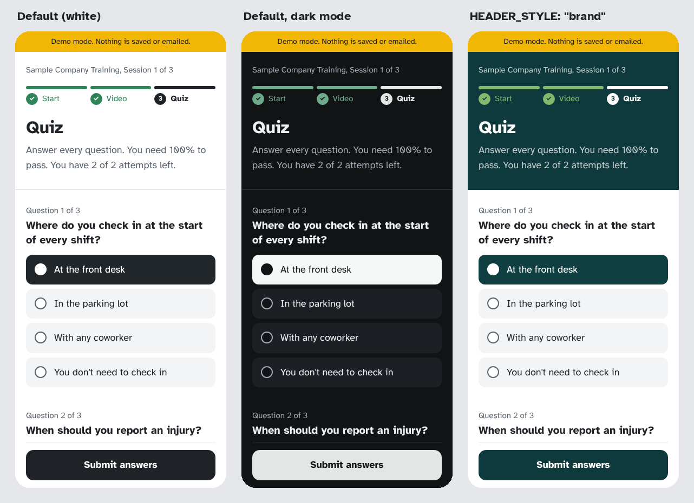

# Customizing ReadyLine

All your settings live in two places:

- **`apps-script/Code.gs`**, in the **YOUR SETTINGS** block at the top. This holds the training itself: sessions, videos, questions, answers, rules, and the email.
- **`site/index.html`**, in the **YOUR SETTINGS** block near the top. This holds what the page needs before anyone signs in: the script address, the bot check key, your name, contacts, and colors.

A few settings appear in both files. They're marked below, and they need to match.

## After you change something

| You changed | Then |
|---|---|
| Code.gs | Save, then Deploy > Manage deployments > pencil > **New version** > Deploy |
| Sessions in Code.gs | Also run **setup** (it checks your sessions and updates the Overrides dropdown) |
| Videos | Upload to R2, run **testVideoLinks**, and raise that session's `version` |
| index.html | Make a new zip and upload it in Cloudflare Pages (Create deployment) |

## Settings in Code.gs

| Setting | What it does | Example |
|---|---|---|
| `TRAINING_NAME` | The training's name in each language. **Match it in index.html.** | `{ en: "Acme Safety Training", es: "Capacitación de Seguridad Acme" }` |
| `SENDER_NAME` | The sender name on the link email | `"Acme Staffing Training"` |
| `TRAINING_URL` | Your page's address, with the slash at the end | `"https://acme-training.pages.dev/"` |
| `ONBOARDING_CODE` | The access code people type to register. Not case-sensitive. | `"maple-river-anchor"` |
| `LANGUAGES` | `["en"]`, `["es"]`, or `["en", "es"]`. The first is the default. **Match it in index.html.** | `["en", "es"]` |
| `SUPPORT_CONTACTS` | Who to contact for help, listed in the email | `[{ name: "Jordan", email: "jordan@acme.com" }]` |
| `PASS_PERCENT` | Score needed to pass | `100` or `80` |
| `MAX_ATTEMPTS` | Quiz attempts per session before staff must grant more | `2` |
| `R2_ACCOUNT_ID`, `R2_BUCKET` | Where your videos are stored | from Cloudflare |
| `VIDEO_LINK_HOURS` | How long each video link works. Keep it longer than anyone needs to finish a video. | `12` |
| `MAX_REGISTRATION_EMAILS_PER_HOUR`, `_PER_DAY` | Caps that protect your email quota from floods | `60`, `300` |
| `MAX_LINK_SENDS` | Emails allowed per address, the first send included | `5` |

### Sessions

Each session in `SESSIONS` looks like this:

```js
{
  id: "session-1", version: "v1",
  title: { en: "Welcome to the team", es: "Bienvenido al equipo" },
  minutes: { en: 13, es: 17 },
  videos: { en: "session-1-en.mp4", es: "session-1-es.mp4" },
  questions: [
    { answer: 0,
      en: { q: "Where do you check in?", a: ["At the front desk", "In the parking lot", "With a coworker"] },
      es: { q: "¿Dónde se registra?", a: ["En la recepción", "En el estacionamiento", "Con un compañero"] } }
  ]
}
```

- **`id`**: lowercase letters, numbers, and hyphens. It appears in the Sheet and the Overrides dropdown. Don't change the id of a session people have already taken, or their past results won't count toward it.
- **`version`**: raise it (`v1` to `v2`) when you replace the video or change the questions. Results record which version each person took, and learners' saved video progress resets for the new version.
- **`captions`**: optional caption files, one per language. See [CAPTIONS.md](CAPTIONS.md).
- **`answer`**: the correct option, counted from 0. In the example, 0 means "At the front desk." True/false questions work the same way: `a: ["True", "False"]` with `answer: 0` for true.
- **Keep the options in the same order in every language.** One answer number serves both languages.
- Add as many sessions and questions as you need. One session works too; the page adjusts its wording.

**setup** checks every session and stops with a plain list of problems: a missing video name, an answer number past the last option, a language with fewer options than the other.

**The easiest way to build this block** is the [quiz templates](QUIZ-TEMPLATE.md): fill in two spreadsheets, and a prompt or a script turns them into this block.

## Settings in index.html

| Setting | What it does |
|---|---|
| `SCRIPT_URL` | Your Apps Script web app address, ending in `/exec`. Empty means demo mode. |
| `TURNSTILE_SITE_KEY` | Your Turnstile Site Key (public) |
| `TRAINING_NAME`, `LANGUAGES` | **Must match Code.gs** |
| `ORGANIZATION` | Your name as learners know it. Used in "Acme gave you this code." |
| `CONTACTS` | Who to contact for help. Shown when someone runs out of attempts and on the resend screen. |
| `BRAND_COLOR` | Buttons and selected answers. White text sits on it, so choose a dark shade. Default: charcoal `#1F2328`. |
| `ACCENT_COLOR` | Progress bars, finished steps, and pass marks. Default: green `#2F855A`. |
| `HEADER_STYLE` | `"white"` (default) for a plain white header, or `"brand"` for a header filled with your brand color |

### Colors

Out of the box, ReadyLine is a plain white page with charcoal buttons and a green mark for progress. It follows each learner's phone or computer into dark mode on its own.

To use your own colors, set `BRAND_COLOR` and `ACCENT_COLOR` as hex codes (like `"#0F3A3D"`). For a bolder look, set `HEADER_STYLE` to `"brand"` and the top of every screen fills with your brand color.



The "Choose brand colors" prompt in [AI-PROMPTS.md](AI-PROMPTS.md) picks shades from your palette that are easy to read.

## Common changes

**Change the passing score or attempts.** Edit `PASS_PERCENT` (1 to 100) or `MAX_ATTEMPTS` in Code.gs, save, and redeploy. The page wording updates on its own. Raising attempts gives everyone the extra tries, including people who had run out. Lowering them locks out anyone who has already used the new number without passing. A new passing score applies to new attempts only. For one person, use the Overrides tab instead.

**Change the access code.** Edit `ONBOARDING_CODE`, save, redeploy. Links people already have keep working.

**Replace a video.** Upload the new file to R2 with the same name, run **testVideoLinks**, raise the session's `version` in Code.gs, and redeploy.

**Fix a question's wording.** Edit it in Code.gs and redeploy. Raise the `version` if the meaning changed.

**Add a session.** Add an entry to `SESSIONS`, upload its videos, run **setup** and **testVideoLinks**, and redeploy. People who already finished everything will see the new session the next time they open their link.

**Offer only one language.** Set `LANGUAGES` to `["en"]` (or `["es"]`) in both files. You can leave out the other language from your sessions. The language screen is skipped.

**Change the wording on the page.** All page text is in the `TEXT` section of index.html, in English and Spanish. Placeholders in curly braces (like `{t}` for the training name) are filled in automatically, so keep them.

**Change the email.** It's written in the `sendLink` function in Code.gs. The email never includes anything a person typed, which keeps the form from being used to send messages in your name. Keep it that way.

## Demo mode

With `SCRIPT_URL` left empty, the page runs on its own with the sample sessions from `site/demo.js`. Nothing is saved or emailed. It's handy for showing the tool to your team before setup.

`tools/build-demo.js` rebuilds `demo.js` from the sample settings in Code.gs. It refuses to run once Code.gs has your real settings, because demo.js shows answers in plain view. Don't upload demo.js to your live site.
